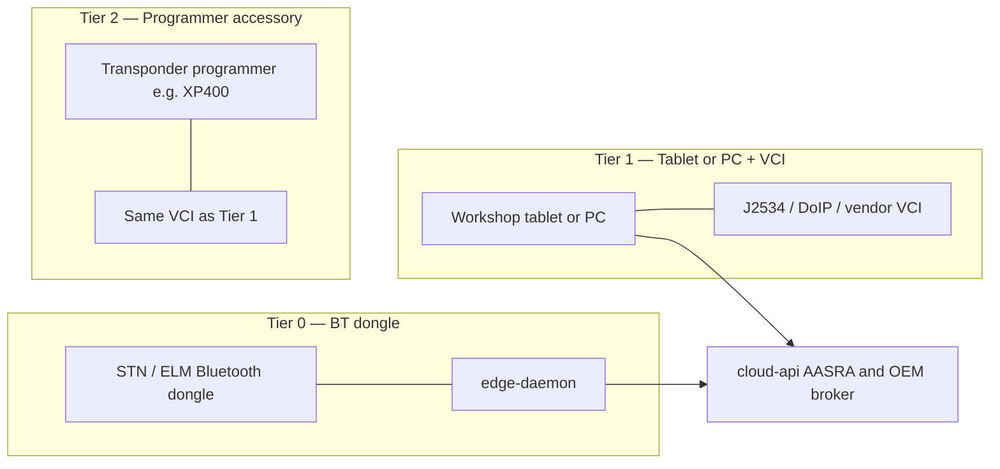
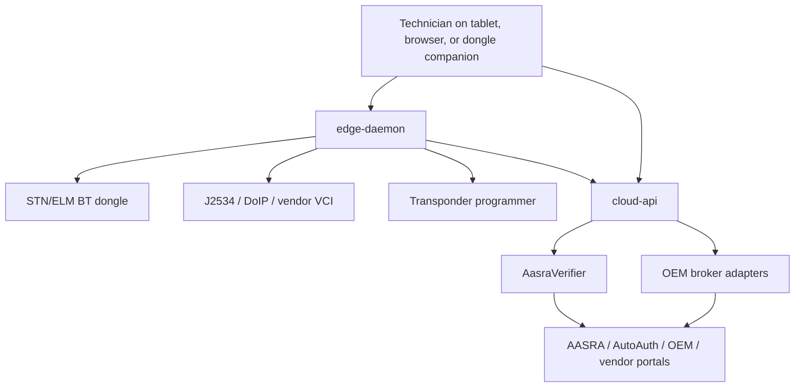
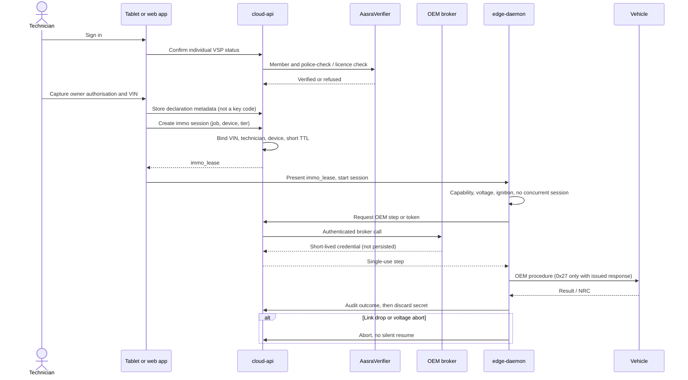

# Immobilizer and key programming

Status: draft design, not implemented.
Date: 2026-11-25 (Australia/Adelaide).
Branch: `rootcause-fixes` (local only).

This document is a scope expansion over the 19 November 2026 autoplan
review, which listed immobilizer key programming as out of scope except
for AASRA-gated broker endpoints
(`docs/reviews/2026-11-19-autoplan-review.md`). Jack asked whether the
product can do immobilizers and key generation, and then asked that the
work cover both a Bluetooth dongle path and a workshop tablet or
Autel-like device when the dongle is not enough.

Nothing here is scheduled or implemented. Existing stubs stay fail-closed
until a later implementation task is approved.

## 1. Hard constraints

The product will **not**:

- Ship, embed, or reverse-engineer OEM seed/key algorithms.
- Extract immobilizer PINs, key codes, or security access secrets from
  the vehicle, EEPROM, or a transponder in order to bypass OEM security.
- Clone transponders or dump immobilizer modules as a substitute for
  OEM-issued credentials.
- Persist PIN, immobiliser, or key codes in any written or electronic
  form (AASRA subscription terms, clause 8.5; see Sources).
- Trust client-supplied flags such as `aasra_verified` or
  `vsp_authorized`. That rule already exists in
  `services/cloud-api/app/services/aasra.py`.

Keys, PINs, and SecurityAccess responses come only from legitimate
sources, used in real time and discarded after the session:

- The Australian Motor Vehicle Service and Repair Information Sharing
  Scheme (MVIS), via AASRA, after the individual meets the statutory
  fit-and-proper tests.
- OEM secure gateways and key brokers (for example Stellantis SGW via
  AutoAuth, Ford PATS via the OEM portal or NASTF-style VSP credentials,
  VW / BMW / Mercedes online OEM key ordering).
- Licensed tool vendors' online services, when the workshop uses a
  certified Autel, Launch, or similar kit under that vendor's licence.

UDS/KWP `0x27` SecurityAccess remains a gated tier-A service in
`packages/schemas/safety_policy.json`. A later change may raise
immobilizer programming to a stricter interlock (section 9), but the
daemon still never computes a key itself. It only forwards an
OEM-issued, short-lived response bound to an `immo_lease`.

## 2. Goals and non-goals

### Goals

- Let a verified Australian technician, with owner authorisation, add or
  replace keys and perform related immobilizer work through legitimate
  OEM or licensed-vendor channels.
- Support two first-class hardware paths:
  - **Dongle path:** the existing edge-daemon, over an STN/ELM Bluetooth
    dongle, runs an OEM-gated on-board key-learn or PIN/token session
    when the vehicle and OEM support that over OBD.
  - **Tablet / VCI path:** a workshop tablet or PC plus a high-current
    J2534, DoIP, or vendor VCI, and optionally a transponder programmer
    (for example Autel IM508/IM608 with XP400 and MaxiFlash), for work
    the dongle cannot do.
- Issue a short-lived `immo_lease` bound to VIN, technician, and device.
  The ordinary 72-hour diagnostic lease must not grant immobilizer
  features.
- Keep a five-year audit of every security-information request and
  session, without storing the secrets themselves.
- Fail closed when AASRA status, owner declaration, OEM token, hardware
  capability, or vehicle preconditions are missing or stale.

### Non-goals

- A built-in library of OEM immobilizer algorithms or "all keys lost"
  procedures that recover secrets from the car.
- EEPROM reading, transponder cloning, or PIN extraction.
- Using the Bluetooth dongle as a transponder coil, key cutter, or
  bench programmer.
- Making Community-tier or unverified accounts able to request security
  information.
- Replacing the licensed Autel/Launch/OEM tool where that tool is the
  legal path for a given vehicle.
- Changing the running local stack as part of this design.

## 3. What exists today

| Area | Current state |
| --- | --- |
| Plan scope | Immobilizer key programming is out of scope except AASRA-gated broker endpoints. ECU flashing is also out of scope. Mobile-native apps and DoIP/CAN FD were held out of the original plan. |
| AASRA verifier | `FailClosedAasraVerifier` trusts only `tenants.aasra_verified`, set by an operator or by the local-only `POST /api/v1/auth/dev-mark-aasra` hook. No AASRA member lookup, no per-technician VSP check. |
| Gateways | `POST /api/v1/gateways/aasra/verify` reports eligibility from that tenant flag. `POST /api/v1/gateways/sgw/unlock` makes the same check and then answers `not_available` (no OEM gateway service is integrated; it used to hand out a 900 s diagnostic edge lease). Neither binds VIN, technician, or device, and neither issues an immobilizer lease. |
| Leases | Ed25519 JWT, `aud=edge-daemon`, up to 72 h. Claims: `tenant_id`, `tier`, `features`, `aasra_verified`. Features are only `J2534`, `UDS_ACTIVE`, `CAN_RE_PRO`. |
| Safety | `SafetyInterlock` gates `0x27`. One NRC `0x35` (invalid key) halts SecurityAccess to that ECU for the session. NRC `0x36`/`0x37` halt for 10 s (`DEFAULT_SECURITY_DELAY`) when the ECU does not report a delay. Tier B (programming session, download/upload) already requires speed 0, RPM 0, and battery ≥ 12.5 V. |
| Simulator | Virtual ECUs implement a fake seed/key and lockout, for tests only. |
| Topology | `PIM_IMMOBILIZER` appears as a node name only. |
| Hardware | STN/ELM, SocketCAN, K-line FTDI, and a 32-bit `j2534-bridge` already exist. There is no transponder programmer HAL and no `immo_lease`. |

The tenant-level `aasra_verified` flag is not enough for this work. The
scheme requires the **individual** who accesses security information to
be a fit and proper person, and to have an appropriate relationship with
an Australian repairer or scheme RTO.

## 4. Australian MVIS / AASRA requirements

The Motor Vehicle Information Scheme is mandatory under Part IVE of the
*Competition and Consumer Act 2010* and took effect on 1 July 2022. The
ACCC enforces it. Security information is scheme information about the
locking and immobilising of a vehicle that is unique to the vehicle
and/or only usable for a limited time (for example a key code, an
immobilizer PIN, or a time-limited reset code).

Before a data provider supplies security information, all of the
following must hold:

1. The information will be used solely for an Australian repairer's
   business, or for a scheme RTO course.
2. The individual is a fit and proper person under the scheme rules.
3. The repairer or RTO has declared that the vehicle owner authorised
   access, and has specified the VIN.

An individual is fit and proper for **security** information if their
relationship to the repairer or RTO is appropriate, and they have
either:

- a national police check report dated no earlier than two years before
  the request, with no relevant conviction, plus a written declaration
  that they have not been convicted of an offence since that report; or
- a repairer licence issued or renewed no earlier than two years before
  the request, where that licence took a national (not merely state)
  police check into account, plus the same kind of declaration.

Relevant convictions include: theft with a custodial sentence; theft of
a motor vehicle or component even without a custodial sentence;
deception, fraud, or dishonesty; and tampering with a motor vehicle or
component.

AASRA is the industry portal used to verify credentials and reach
participating manufacturers. AASRA's own Vehicle Security Professional
(VSP) upgrade is stricter than the statutory floor: a national police
check conducted within the last 12 months, and a current certificate of
currency for the business. AASRA also charges manufacturer-set fees for
security information (for example Stellantis key-code and
immobilizer/PIN codes are listed on the AASRA Chrysler page). Technicians
must not store PIN, immobiliser, or key codes, and must not share
security information.

If this product supplies security information, or holds sensitive
information used to decide fit-and-proper status, additional duties
apply:

- Keep a supply record for **five years**: time and date, repairer or
  RTO name and contact details, personal information used in the
  fit-and-proper decision, VIN, and details of the information supplied
  (s 57DE). The record describes the supply; it must not become a PIN
  locker.
- Store that sensitive information in Australia or an external Territory,
  and not enable access from outside Australia (s 57DD). This matches
  the existing `DATA_RESIDENCY_ENFORCE` / `ap-southeast-2` rule.

Recommended legal posture: the technician and their workshop hold the
AASRA VSP and OEM accounts. OBD2-SOFTWARE is the workshop client and
audit log. It brokers short-lived OEM tokens and never becomes a
store of key codes. Confirm with counsel whether any broker behaviour
makes the company a data provider under the Act; if it does, implement
the s 57DE record in full and keep fit-and-proper artefacts in
Australia only.

## 5. Hardware tiers

All three tiers are in scope. The product picks a tier from the
connected adapter and the requested operation, and refuses work the
hardware cannot do safely.



### Tier 0 — Bluetooth dongle (on-board OEM key-learn only)

The existing Rust edge-daemon talks to the vehicle over the STN/ELM
Bluetooth dongle already used for diagnostics. With a valid `immo_lease`
and an OEM-issued PIN or online key-learn token, the daemon may run the
OEM's **on-board** immobilizer procedure: typically "add a key" or
"learn a spare key" on vehicles where the OEM exposes that routine over
the OBD port and supplies the credential online.

The dongle **cannot**:

- Read or write a transponder, RFID coil, or key EEPROM. There is no
  programmer accessory on this path.
- Cut a blade or generate a blank key. The customer must already have a
  compatible blank, or the key must be cut elsewhere.
- Be used for "all keys lost", ECU/IMMO module replacement, or any job
  that needs PIN extraction, EEPROM work, or a bench programmer.
- Be treated as a high-current programming VCI. Many STN/ELM dongles
  share ground and power with the OBD port and have limited ISO-TP
  throughput, no reliable DoIP, and no J2534 programming channels.

Realistic dongle jobs are therefore a subset: late-model or
OEM-supported **add-a-key** (and similar) routines where one working
key may be required, the OEM issues a PIN or session token, and the
car itself programs the new transponder once that token is supplied.
Coverage has to be allow-listed per OEM, model year, and procedure,
not assumed. Candidates, subject to each OEM's published process and
a later compatibility matrix, include some Ford PATS-style on-board
learn sequences, some Japanese and Korean "register additional key
with PIN" flows, and any OEM that offers an online OBD key-learn after
AASRA or VSP authentication. Vehicles that require a Security Gateway
unlock plus a vendor VCI (many late Stellantis), a dedicated IMMO
tool, or a transponder programmer remain Tier 1 or 2.

Dongle-specific interlocks are in section 9.

### Tier 1 — Workshop tablet or PC plus a high-current VCI

Use a tablet app or the existing workshop-PC browser plus edge-daemon,
connected to a J2534 PassThru, DoIP, or vendor VCI (for example Autel
MaxiFlash). This path is required when the job needs stable programming
current, J2534 or DoIP channels, SGW unlock, longer OEM procedures, or
better link reliability than Bluetooth.

The existing 32-bit `j2534-bridge` is the starting point for PassThru
on Windows. DoIP and CAN FD were out of the original plan and would be
an explicit follow-on if a target OEM requires them.

### Tier 2 — Transponder programmer accessory

A coil/programmer such as Autel XP400 Pro, used with the Tier 1 VCI and
tablet. This is the path for generating or identifying blank keys,
writing OEM-supplied key data into a new transponder, and jobs where
the car cannot learn a key by OBD alone. OBD2-SOFTWARE still does not
compute the key data; it obtains it from the OEM or the licensed vendor
service.

### Choosing a tier

| Job | Dongle | Tablet + VCI | + Programmer |
| --- | --- | --- | --- |
| Diagnostics, live data, gated UDS (existing) | Yes | Yes | n/a |
| Add a key, OEM supports on-board learn + online PIN/token | Yes, if allow-listed | Yes | Optional |
| Add a key, OEM requires SGW + vendor VCI or DoIP | No | Yes | Optional |
| All keys lost, IMMO/ECU replace, EEPROM or bench | No | Only if OEM online procedure says so | Usually required |
| Transponder identify / write / blank generation | No | No | Yes |
| Blade cutting | No | No | Vendor or locksmith |

The UI must say which tier a job needs before the technician starts,
and must refuse to start an `immo_lease` on hardware that cannot do it.

## 6. Component responsibilities



| Component | Responsibility |
| --- | --- |
| Tablet app / web Live page | Enrolment UX, owner-authorisation capture, VIN confirmation, job and hardware-tier selection, safety checklist, session progress, abort. No PIN display after use, no local secret store. |
| edge-daemon | Adapter capability check, `immo_lease` verification, safety interlock, single-session lock, execution of OEM-supplied steps on the bus, BT link-drop handling on the dongle path, audit events. Never derives a SecurityAccess key. |
| cloud-api broker | Session creation, entitlement checks, `immo_lease` issue, token relay, audit persistence, residency. |
| `AasraVerifier` | Replace the fail-closed stub with a real AASRA member and VSP lookup for the **individual**, plus relationship to the tenant repairer. Still fail closed on error or stale checks. |
| OEM broker adapters | Per-OEM modules (AutoAuth, Ford, VAG, BMW, Mercedes, and later others) that obtain a short-lived token or procedure step from the OEM or licensed vendor. Adapters return opaque, single-use material to the daemon and do not log the secret. |
| Licensed vendor tool (optional) | When the Autel (or similar) kit runs the vehicle procedure, OBD2 records the job, checks AASRA/owner/VIN, and does not drive the vendor's proprietary protocol. |

## 7. End-to-end flow



Steps in words:

1. The technician signs in. cloud-api loads their individual AASRA/VSP
   record, not a tenant-wide flag. Stale police check or licence (older
   than the statutory two years, or older than AASRA's 12-month VSP
   policy if that is the enrolment path) refuses the job.
2. The technician records owner authorisation and the full VIN, and
   confirms they are with the vehicle. Evidence (for example a copy of
   the owner's licence, where an OEM or AASRA AIR-style flow requires
   it) is stored in Australia under the existing VIN-redaction rules.
3. The app identifies the vehicle and looks up an allow-listed
   procedure. The procedure names the hardware tier and the OEM adapter.
4. cloud-api issues an `immo_lease` (section 8) only after steps 1–3
   succeed.
5. The daemon checks hardware, battery, ignition, and exclusivity, then
   requests each OEM step just in time. SecurityAccess key material is
   used once and dropped from memory.
6. Success, refusal, NRC lockout, or abort is audited. The lease is
   revoked. No PIN remains on the device, in logs, or in the database.

## 8. Lease and entitlement changes

Do not extend the 72-hour diagnostic lease with an immobilizer feature
flag. A diagnostic lease can be used offline; an immobilizer session
must not.

Introduce a distinct `immo_lease` JWT, still Ed25519, with at least:

| Claim | Rule |
| --- | --- |
| `aud` | `edge-daemon-immo` (new audience; a diagnostic lease is rejected) |
| `typ` / `lease_kind` | `immo_lease` |
| `session_id` | Cloud session primary key |
| `sub` / `user_id` | The verified technician, not merely the tenant |
| `tenant_id` | Workshop |
| `vin` or `vin_hmac` | Bound to the authorised vehicle; daemon compares to the VIN it reads |
| `device_id` | Dongle serial, VCI serial, or programmer + VCI pair |
| `device_tier` | `dongle`, `vci`, or `vci_programmer` |
| `oem` | Adapter that may be called |
| `operation` | Allow-listed job, for example `add_key_onboard` |
| `aasra_verified` | Must be true, and freshly checked at issue time |
| `features` | `IMMO_PROGRAM` only; do not include it on diagnostic leases |
| `nbf` / `exp` | Short TTL: 15 minutes default, hard cap 30 minutes |
| `jti` | Unique; daemon and API treat reuse after revoke as invalid |

`KNOWN_FEATURES` in `signing.py` and the Rust `Feature` enum gain
`IMMO_PROGRAM`. `features_for_tier` must not grant it from COMMUNITY,
PRO, or WORKSHOP automatically. Grant it only when an immobilizer
session is created, for a Workshop (or later paid add-on) tenant, and
the technician is VSP-verified.

`POST /api/v1/gateways/sgw/unlock` no longer issues its old 900-second
diagnostic lease; it answers `not_available` (review, 28 Nov 2026). When
an OEM gateway is integrated, SGW unlock becomes a VIN- and device-bound
session token, not a generic capability upgrade.

The daemon refuses `IMMO_PROGRAM` commands when:

- the token is a normal edge lease, or the audience is wrong;
- the VIN on the bus does not match the claim;
- the connected adapter identity does not match `device_id`;
- `device_tier` is `dongle` but the operation requires a VCI or
  programmer;
- the lease is expired, revoked, or already completed.

## 9. Safety interlock rules

Immobilizer work uses the existing `SafetyInterlock`, with a stricter
profile than ordinary tier-A SecurityAccess.

**Preconditions (all tiers)**

- Vehicle speed 0 km/h, reading fresh within 2 s (existing tier A/B).
- Engine RPM 0. Immobilizer programming is treated at least as strictly
  as tier B.
- Battery voltage at or above a configurable floor, default 13.0 V for
  the duration of the session, not only at token issue. A battery
  maintainer or charger is required; the UI must say so before start.
  A drop below the floor mid-procedure aborts.
- Ignition in the state the OEM procedure names (typically ON, engine
  off). If the state cannot be read, fail closed.
- One immobilizer or programming session at a time per vehicle VIN,
  per adapter, and per daemon. A second `immo_lease` is refused until
  the first completes or is aborted.
- `0x27` is allowed only when the current step of the OEM procedure
  calls for it and the response bytes came from the broker in this
  lease. Ad-hoc SecurityAccess from the client is refused.
- Existing NRC policy stands: `0x35` halts SecurityAccess to that ECU
  for the session; `0x36`/`0x37` halt for the reported delay, or 10 s
  if the ECU does not report one. After a halt, do not retry with a
  new token unless the OEM procedure explicitly allows it.

**Abort**

- Operator abort, voltage drop, ignition change, VIN mismatch, or
  lease expiry stops the procedure immediately. The daemon does not
  continue a half-finished write.
- After abort, the daemon attempts only OEM-documented recovery steps
  (for example leaving the default session). If those are not known,
  it stops and tells the technician the vehicle may need a retry under
  a new lease, or a dealer/vendor recovery.
- Every abort is audited.

**Dongle-specific interlocks**

- **Maintainer required.** STN/ELM dongles do not supply programming
  current. The daemon samples battery voltage throughout (existing
  `update_battery` path) and aborts on a drop or a stale reading.
- **Bluetooth link-drop.** A drop, stall, or STN "STOPPED" mid-procedure
  is an abort, not a silent resume. Resume, if allowed at all, requires
  a new OEM step after the technician confirms vehicle state. Never
  replay a used SecurityAccess response.
- **Timing and throughput.** Long OEM procedures, multi-frame ISO-TP,
  or tight session timings that the dongle cannot meet are not run on
  Tier 0. The allow-list records a maximum expected duration and
  minimum transport (for example ISO-TP vs DoIP). If the daemon cannot
  honour the timing, it refuses before the first gated write.
- **No transponder I/O.** Any operation that needs a coil or programmer
  is refused on a dongle, even if the lease was mistakenly issued.
- **Adapter identity.** The lease binds the dongle serial (or
  equivalent). Swapping the dongle mid-session voids the lease.

**VCI / programmer interlocks**

- J2534 use still requires the existing `J2534` diagnostic feature on
  the ordinary lease for non-immo work; immo work uses the `immo_lease`
  plus a programming-capable adapter kind.
- Programmer jobs additionally bind the programmer serial and refuse to
  start if it is missing.

## 10. Audit and retention

Extend the existing append-only `audit_log` (A-CEO-4) rather than
logging secrets into `detail`.

For every immobilizer or security-information event, record at least:

- time and date (timestamptz);
- tenant (repairer) name and contact snapshot;
- technician user id and AASRA member id;
- VIN (stored as `vin_hmac` plus, where s 57DE requires a VIN on a
  data-provider supply record, an Australia-resident encrypted copy
  with a defined access policy — not in ordinary telemetry);
- device id and tier, OEM, operation, session id;
- outcome: requested, issued, allowed, refused, response, aborted,
  completed;
- NRC and OEM error codes, never the PIN or key bytes;
- a pointer to the owner-authorisation record.

Retention for these rows is **five years**, independent of the shorter
telemetry retention in `tier_retention`. Do not evict unsynced edge
rows (existing ring-buffer rule). Fit-and-proper artefacts (police
check metadata, declarations) stay in `ap-southeast-2` and are not
written to Community case publish or traces in S3 without encryption
and purpose limitation.

The daemon redacts VIN in ordinary logs, as the current UI and API
already do for decode.

## 11. Data model and API sketches

Sketches only. Implementation would be a later alembic migration under
the existing RLS pattern.

```text
technician_credentials
  tenant_id, user_id
  aasra_member_id, vsp_status
  national_police_check_dated, declaration_at
  repairer_licence_renewed_at          -- alternative path
  insurance_currency_at                -- AASRA VSP policy
  verified_at, verified_until          -- fail closed after this
  -- no raw police-check documents unless counsel requires them;
  -- if stored, Australia only

owner_authorisations
  id, tenant_id, user_id
  vin_hmac, vin_encrypted_au           -- purpose-limited
  declared_at, evidence_uri            -- AU bucket
  expires_at                           -- per job, short

immo_sessions
  id, tenant_id, user_id, vehicle_id
  oem, operation, device_id, device_tier
  lease_jti, expires_at
  status  -- pending | active | completed | aborted | refused
  authorisation_id

immo_audit  -- or extra columns / event type on audit_log
  ...fields in section 10
  UNIQUE and append-only
```

API sketch (all require a session JWT; entitlements come from the
database, not the request body):

```text
POST /api/v1/immo/technicians/enrol
POST /api/v1/immo/technicians/me          -- fresh AASRA check
POST /api/v1/immo/owner-authorisations
POST /api/v1/immo/sessions                -- issues immo_lease
POST /api/v1/immo/sessions/{id}/steps     -- just-in-time OEM material
POST /api/v1/immo/sessions/{id}/complete
POST /api/v1/immo/sessions/{id}/abort
GET  /api/v1/immo/sessions/{id}
```

Replace or wrap the current gateway stubs:

```text
POST /api/v1/gateways/aasra/verify   -- individual, not tenant flag
POST /api/v1/gateways/sgw/unlock     -- VIN-bound, short-lived, no 72 h lease
```

`AasraVerifier.is_verified(tenant_id, tenant_flag)` should become a
check of `(tenant_id, user_id)` against AASRA and
`technician_credentials`, still failing closed. The tenant flag may
remain as a workshop-level hint but is never sufficient.

OEM adapters behind the steps endpoint, for example:

- `StellantisAutoAuthAdapter` — SGW unlock and, where AASRA lists
  key-code / PIN supply, a one-time retrieve.
- `FordPatsAdapter` — OEM portal or VSP-credentialled online learn.
- Later: VW, BMW, Mercedes online key-ordering adapters.

Adapters take the session context and return an opaque step. They do
not accept a client-supplied key. Errors from the OEM are passed
through as refusals and audited.

## 12. Vendor integration option

Building a complete transponder and OEM-procedure product is a
multi-year effort that Autel, Launch, and OEM tools already sell.
The design therefore includes a first-class integration option, which
can ship beside the native dongle and VCI paths.

A practical workshop kit, used as the reference, is Autel MaxiIM IM508
or IM608 Pro, with XP400 Pro and a MaxiFlash / J2534 VCI. Other
licensed kits can be certified the same way.

Two integration shapes:

1. **Guided job and audit wrapper (recommended first for Tier 2).**
   OBD2 runs enrolment, owner declaration, VIN binding, and the
   five-year audit. It tells the technician which Autel (or other)
   function to run and records start/end and outcome. The vendor tool
   talks to the vehicle and to its own licensed online service. OBD2
   does not reverse-engineer that protocol.
2. **Shared VCI / OEM account.** Where the vendor or OEM documents a
   supported interface (J2534 OEM programming on a PC, AutoAuth tool
   registration, and similar), the edge-daemon or a Windows helper
   may drive the documented path under an `immo_lease`.

This option does not replace the dongle path. It covers the jobs the
dongle cannot do, and it is the honest answer when the OEM's only
supported tool is a licensed IMMO tablet.

## 13. Recommended approach and decisions

Recommended product shape:

- **Tier 0 first for native work:** on-board, OEM-gated add-a-key (and
  similar) over the STN/ELM Bluetooth dongle the workshop already has,
  with a maintainer, a short `immo_lease`, and a strict allow-list.
  This is the path that stays inside the existing daemon.
- **Tier 1/2 in parallel, vendor-assisted:** workshop tablet or PC plus
  a certified VCI, and an Autel-class programmer kit for transponder
  work and vehicles the dongle cannot serve. Prefer the audit-wrapper
  integration before building a native programmer HAL.
- **Broker, do not invent:** AASRA and OEM adapters supply every secret.
  No algorithm pack.

Decisions Jack should make before implementation:

1. Whether the first native target is one allow-listed OEM on-board
   learn over the dongle, or the Autel audit-wrapper first, or both in
   one phase.
2. Who holds AASRA VSP and OEM accounts: the technician (recommended)
   or the company as a broker (heavier s 57DE / 57DD duties).
3. Which VCI and programmer kit to certify first, if not Autel
   IM508/IM608 + XP400 + MaxiFlash.
4. Whether immobilizer is part of WORKSHOP or a paid add-on, and
   whether FLEET (today stored as WORKSHOP) is included.
5. The first OEM adapter after the AASRA verifier: Stellantis AutoAuth
   / AASRA security request, Ford, or another daily-driver brand.
6. Counsel sign-off on data-provider status, five-year records, and
   storage of owner-authorisation evidence.

## 14. Phased roadmap

Both the dongle and tablet/VCI tiers are in the roadmap. Later phases
do not start until the earlier verification gate is agreed.

**Phase 0 — Policy (this document).** No code changes required beyond
publishing the design.

**Phase 1 — Identity, authorisation, audit.** Real `AasraVerifier`
(individual VSP, police check or licence dates, relationship to the
repairer). Owner-authorisation records. Five-year `immo_audit` without
secrets. Per-technician credentials. Still no vehicle writes.

**Phase 2 — `immo_lease` and hardware gates.** New audience and claims,
VIN and device binding, short TTL, revoke on complete/abort. Daemon
refuses immobilizer commands on a diagnostic lease. Adapter capability
matrix: dongle vs J2534/VCI vs programmer. Tighten
`/gateways/sgw/unlock`.

**Phase 3 — Dongle path (Tier 0).** One allow-listed OEM on-board
key-learn over STN/ELM: maintainer and live voltage, BT drop abort,
timing budget, no transponder I/O, just-in-time OEM token, SecurityAccess
only with broker-issued bytes. Simulator coverage first, then a bench
vehicle. Expand the allow-list OEM by OEM.

**Phase 4 — Tablet / VCI path (Tier 1).** Workshop tablet or PC UX,
high-current VCI / J2534 (and DoIP if a chosen OEM requires it), SGW
unlock as a bound session, longer OEM procedures that the dongle
cannot time or power.

**Phase 5 — Programmer and vendor kit (Tier 2).** Either certify Autel
(or another licensed kit) as the audit-wrapper path, or add a documented
programmer accessory HAL if a vendor provides a supported interface.
No cloned transponder workflows.

**Phase 6 — More OEM adapters and operations.** Ford, VW, BMW, Mercedes,
and others, each with an explicit dongle vs VCI vs programmer
classification. All-keys-lost only where the OEM online process
supports it without secret extraction.

## 15. Risks

| Risk | Mitigation |
| --- | --- |
| Legal: shipping or reconstructing algorithms, PIN extraction, or cloning | Hard constraint. Allow-list only OEM or licensed-vendor procedures. Code review and testers watch for algorithm packs. |
| Legal: becoming a data provider, or storing PINs contrary to AASRA terms | Do not persist secrets. Counsel on broker status. Five-year metadata, Australia-resident sensitive data. |
| Stale or tenant-only AASRA status | Per-technician verification with expiry; fail closed. |
| Bricking an immobilizer or leaving a vehicle no-start | Strict preconditions, no concurrent sessions, abort without replay, allow-list only, maintainer required. |
| BT dongle drop or brown-out mid-learn | Abort, not resume, with a new OEM step if the technician retries. Voltage floor throughout. |
| Operator tries a VCI-only job on a dongle | Capability check at lease issue and again on the daemon. |
| Lease theft or device swap | Short TTL, `jti` revoke, VIN and device binding, no offline immo lease. |
| Insider misuse | Individual VSP, owner declaration, five-year audit, no shared workshop login. |
| Coverage disappointment | Be explicit that dongle support is on-board learn only and allow-listed; Autel-class kits cover the rest. |
| OEM or AASRA API change, fees, or outage | Fail closed; surface the OEM/AASRA error; no local fallback algorithm. |
| Scope creep into ECU flashing | Flashing stays out of scope except where an OEM key procedure truly requires a documented, brokered programming session under the same interlocks. |

## 16. Sources

Accessed 25 November 2026.

1. *Competition and Consumer Act 2010* (Cth), Part IVE, including
   ss 57AA (security information), 57DB (restrictions on supply, owner
   declaration and VIN), 57DD (storage of and access to sensitive
   information in Australia), and 57DE (security information records of
   access, five years).
   <https://www.legislation.gov.au/C2004A00109/latest>
   Consolidated text also at
   <https://austlii.edu.au/cgi-bin/viewdoc/au/legis/cth/consol_act/caca2010265/s57de.html>
   and
   <https://austlii.edu.au/au/legis/cth/consol_act/caca2010265/s57dd.html>.
2. *Competition and Consumer Amendment (Motor Vehicle Service and Repair
   Information Sharing Scheme) Act 2021* (Cth).
   <https://www.legislation.gov.au/C2021A00054>
3. *Competition and Consumer (Motor Vehicle Service and Repair
   Information Sharing Scheme) Rules 2021* (Cth), s 7 (fit and proper
   criteria, two-year national police check or repairer licence,
   relevant offences).
   <https://www.legislation.gov.au/F2021L01464>
4. ACCC, "Motor vehicle information scheme — information for industry"
   (scheme in effect 1 July 2022; data-provider guidance updated
   5 June 2025).
   <https://www.accc.gov.au/by-industry/cars-and-vehicles/about-the-motor-vehicle-information-scheme/motor-vehicle-information-scheme-information-for-industry>
5. ACCC, *Motor Vehicle Service and Repair Information Sharing Scheme —
   Guidance for data providers* (PDF). Definition of security
   information, fit-and-proper tests, owner declaration and VIN.
   <https://www.accc.gov.au/system/files/mvis-accc-guidance-data-providers.pdf>
6. AASRA, "Vehicle Security Professional (SDRM)" (individual
   relationship to a repairer or RTO; two-year national police check
   and disqualifying offences).
   <https://aasra.com.au/?page_id=367>
7. AASRA, "Security Upgrade" (VSP upgrade: national police check
   within 12 months, certificate of currency; access to key and
   immobiliser codes for participating manufacturers).
   <https://aasra.com.au/?page_id=5781>
8. AASRA, *Frequently Asked Questions* (PDF, July 2022): national
   police check meaning, disqualifying offences, two-year statutory
   currency, VSP fees, manufacturer charges.
   <https://aasra.com.au/wp-content/uploads/2022/07/AASRA-Frequently-Asked-Questions-FAQs.pdf>
9. AASRA, *Subscription Terms* (PDF, June 2022), clause 8.5: owner
   authorisation declaration; do not store PIN, immobiliser, or key
   codes; do not share security information.
   <https://aasra.com.au/wp-content/uploads/2022/06/Subscription-Terms.pdf>
10. AASRA, Chrysler / Stellantis manufacturer page (example
    security-information fees: key code and immobilizer/PIN code).
    <https://aasra.com.au/?page_id=2770>
11. Stellantis Australia, independent service and repair information
    (AASRA account required).
    <https://www.fiat.com.au/legal/aasra-service-repair-information>
12. AutoAuth / Stellantis SGW documentation as used by independent
    tools (technician and tool registration; OEM-managed credentials).
    Example vendor explanation:
    <https://www.iscantech.com/autoauth/>
13. Autel, J2534 programming overview and XP400 Pro / MaxiIM product
    pages (reference hardware for Tier 1/2, not a protocol spec).
    <https://autel.us/j2534-programming/>
    <https://www.autel.com/immotool1/3588.jhtml>
14. In-repo: `docs/reviews/2026-11-19-autoplan-review.md`,
    `docs/PLAN.md`, `docs/architecture.md`,
    `services/cloud-api/app/services/aasra.py`,
    `services/cloud-api/app/api/v1/gateways.py`,
    `services/cloud-api/app/services/signing.py`,
    `packages/schemas/safety_policy.json`,
    `apps/edge-daemon/src/auth/lease.rs`,
    `apps/edge-daemon/src/safety/interlock.rs`.
